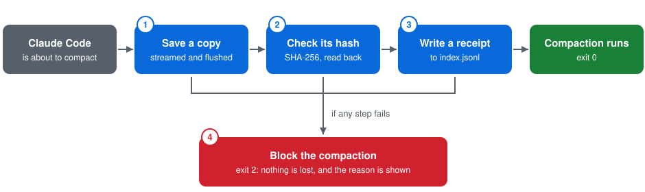

# compaction-guard

[](https://github.com/keeganarko/compaction-guard/actions/workflows/test.yml)

Before an AI coding agent compacts its conversation, compaction-guard saves an
exact copy, checks the copy by hash, and blocks the compaction if the save
fails.

Version 0.2.0 works with Claude Code. It has one file and no dependencies, and
needs Node.js 18 or later. It is source-available under FSL-1.1-MIT, not open
source; see [License](#license). The picture version of this page is
[README.html](README.html).

## Why

A coding agent can only hold so much conversation. Near that limit, Claude Code
compacts: it replaces the conversation with a summary and carries on from
there. The agent no longer sees anything the summary leaves out.

compaction-guard makes a checked copy of the full transcript at the moment of
each compaction. It keeps the copy outside the agent's own storage, so the copy
survives if that storage is cleaned up or changed. If the copy can't be made
and checked, the compaction doesn't happen.

The background is in the post
[Agents need direction more than anything](https://www.keegan-studio.com/writing/agents-need-direction.html).

## How it works



Claude Code runs compaction-guard as a `PreCompact` hook. It passes JSON on
stdin that includes `session_id`, `transcript_path`, `cwd`, `hook_event_name`
and `trigger` (`manual` for `/compact`, `auto` near the limit). Then:

1. **Save a copy.** Stream the transcript into a new temporary file in the
   archive, computing its SHA-256 while reading, and flush it to disk. If the
   transcript's size or modification time changed during the copy, discard
   the copy and try again, up to three times. Rename the copy into place and
   flush the folder.
2. **Check its hash.** Read the saved copy back and check that its size and
   SHA-256 match what was read.
3. **Write a receipt.** Append one line to `index.jsonl` and flush it. Exit 0,
   and the compaction goes ahead.
4. **Block the compaction if any step fails.** Exit 2 with a plain reason on
   stderr. Claude Code blocks the compaction, and nothing is lost.

## Install

```sh
git clone https://github.com/keeganarko/compaction-guard.git
cd compaction-guard
npm test
```

Add the hook to `~/.claude/settings.json` (every project) or to a project's
`.claude/settings.json`. Use the absolute path to your clone:

```json
{
  "hooks": {
    "PreCompact": [
      {
        "hooks": [
          {
            "type": "command",
            "command": "node /absolute/path/to/compaction-guard/compaction-guard.mjs"
          }
        ]
      }
    ]
  }
}
```

Without a `matcher` the hook runs on both manual and automatic compaction. Add
`"matcher": "manual"` to guard only `/compact`. The same file is in
[examples/claude-settings.json](examples/claude-settings.json).

To check it: run `/compact` in Claude Code, then run
`node compaction-guard.mjs verify`.

## Archive

```text
~/.compaction-guard/
  index.jsonl                                  one receipt per saved copy
  <project>/<session_id>/<UTC time>-<trigger>-<random>.jsonl
```

`<project>` is the name of the folder Claude Code keeps the transcript in. On
macOS and Linux, folders are created `0700` and files `0600`. On Windows, the
archive inherits its folder's permissions.

A receipt looks like this:

```json
{"version":1,"saved_at":"2026-09-23T10:28:47.620Z","session_id":"89b0ab10-…","trigger":"manual","source":"/home/you/.claude/projects/<project>/89b0ab10-….jsonl","archive":"<project>/89b0ab10-…/2026-09-23T10-28-47-606Z-manual-3a85e6b1.jsonl","bytes":248342,"sha256":"2b068bef…"}
```

`archive` is relative to the archive folder, so you can move the whole folder.

## Check the archive

```sh
node compaction-guard.mjs verify
```

`verify` hashes every copy named in `index.jsonl` again. It reports each one
as verified, missing, changed, or invalid (unreadable, or pointing outside the
archive). It exits 0 only if every receipt is verified.

```text
$ node compaction-guard.mjs verify
2 receipts in /Users/you/.compaction-guard
  verified  1
  missing   0
  changed   1
  invalid   0
changed: -Users-you-code-app/5f0c2a9e-…/2026-10-15T19-15-31-235Z-auto-bfd636df.jsonl
```

## Restore a copy

```sh
node compaction-guard.mjs restore <receipt id | sha256> [--to <path>] [--force]
```

`restore` hashes the saved copy and compares it with its receipt before it
writes anything. It then copies the bytes through a temporary file, checking
the hash again on the way, and puts the file in place.

- **Which copy.** A receipt id is the saved copy's file name without `.jsonl`,
  as `verify` and the receipt's `archive` field show it. You can also give the
  SHA-256, or its first 8 or more hex digits. If several receipts hold the
  same contents, the newest copy that still matches is used. If a hash prefix
  matches different contents, nothing is restored and the matches are listed.
- **Where it goes.** Without `--to`, back to the path it was saved from (the
  receipt's `source`). With `--to`, to that file, or into that folder under its
  original name. The folder must exist, and it can't be inside the archive.
- **Nothing is replaced unless you ask.** If a file is already there,
  `restore` refuses and exits 1. Add `--force` to replace it.

Restore by receipt id into a folder:

```text
$ node compaction-guard.mjs restore 2026-10-15T19-15-31-178Z-manual-7cd9dd55 --to ~/restored
Restored 2026-10-15T19-15-31-178Z-manual-7cd9dd55 to /Users/you/restored/5f0c2a9e-….jsonl: 29092 bytes, sha256 8c9ea86b…, checked against its receipt.
```

Restore by hash to where it came from, while the original is still there:

```text
$ node compaction-guard.mjs restore 8c9ea86b
compaction-guard restore: /Users/you/.claude/projects/-Users-you-code-app/5f0c2a9e-….jsonl already exists; pass --force to replace it, or --to <path> to restore somewhere else
```

## Configuration

| Setting | Effect |
|---|---|
| `--dir <path>` | Archive folder. Wins over the variable below. |
| `COMPACTION_GUARD_DIR` | Archive folder, if `--dir` isn't given. The default is `~/.compaction-guard`. Use an absolute path. |
| `COMPACTION_GUARD_FAIL_OPEN=1` | If a save fails, let compaction continue anyway (exit 1) instead of blocking it (exit 2). |
| `--to <path>` | `restore` only. Where to write the copy: a file, or an existing folder. The default is the path it was saved from. |
| `--force` | `restore` only. Replace a file that is already at the destination. |

## Exit codes

| Mode | Code | Meaning |
|---|---|---|
| hook | 0 | Saved and checked, or the event wasn't `PreCompact`. Compaction continues. |
| hook | 1 | The save failed and fail-open is set. Compaction continues without a copy. |
| hook | 2 | The save failed. Claude Code blocks the compaction and shows the reason. |
| verify | 0 | Every receipt verified, or there are no receipts yet. |
| verify | 1 | At least one copy is missing or changed, or a receipt is invalid. |
| verify | 2 | The archive couldn't be read, or an argument was wrong. |
| restore | 0 | The copy matched its receipt and was written. |
| restore | 1 | Refused, and nothing was written: no receipt matches, a file is already there and `--force` wasn't given, or no saved copy matches its receipt. |
| restore | 2 | An argument was wrong, the destination folder doesn't exist, or a read or write failed. |

In hook mode stdout stays empty, because Claude Code reads hook stdout as a
decision. Status goes to stderr.

## Before you install

- **Blocking an automatic compaction can fail your request.** Claude Code's
  [hooks documentation](https://code.claude.com/docs/en/hooks) says that if a
  hook blocks an automatic compaction that was recovering from a context-limit
  error, that request fails. The usual causes are a full disk or a folder you
  can't write to. Fix the cause, or set `COMPACTION_GUARD_FAIL_OPEN=1`.
- **The archive holds whole conversations.** That means code, file contents,
  and anything pasted into the chat, including secrets. It stays on your
  machine. Don't put it in a synced or shared folder, and never commit it.
- **Nothing is deleted.** Every compaction adds a copy, so disk use grows.
  Prune old copies yourself; `verify` will then list their receipts as missing.
- **It changes nothing unless you ask.** The hook copies a conversation byte
  for byte; it never parses, summarizes or edits it. `restore` writes only
  when you run it, and replaces a file only with `--force`.
- **Claude Code only, for now.** Other agents have their own hooks, but they
  haven't been checked for this.

## What was verified

For 0.2.0, on 2026-10-15:

- `npm test`: 31 of 31 tests pass on Linux (WSL2) with Node.js 18.20.8 and
  24.19.0, and in
  [CI](https://github.com/keeganarko/compaction-guard/actions/runs/38793591877)
  on Linux and macOS with Node.js 18.20.8 and 24.21.0.
- Live run in Claude Code 2.1.301 with the hook installed. `/compact` saved
  the transcript (174,303 bytes) and `verify` confirmed it. `restore` wrote
  the copy out with the same SHA-256, and refused to replace the original
  without `--force`.
- Live failure run: with the archive in a read-only folder, Claude Code
  printed "Compaction blocked by PreCompact hook" with the reason, and the
  conversation wasn't compacted.

For 0.1.0, on 2026-09-23:

- `npm test`: 19 of 19 tests pass on Linux (WSL2) with Node.js 18.20.8,
  20.20.2 and 24.19.0. On Windows with Node.js 24.19.0, 17 pass and the 2
  POSIX-only tests (file modes, unwritable folder) are skipped.
- Live run in Claude Code 2.1.280 with the hook installed. `/compact` saved the
  transcript (248,342 bytes), and `verify` confirmed it.
- Live failure run: with the archive folder unwritable, Claude Code printed
  "Compaction blocked by PreCompact hook" with the reason, and no compaction
  was written to the transcript.

Not verified yet: 0.2.0 on Windows, a live run on macOS (CI runs the tests
there, not Claude Code), and the retry when the transcript changes during the
copy (it has no automated test).

## Development

```sh
npm test                 # the tests: node:test, no dependencies
npx -y node@18 --test    # the oldest supported Node.js
```

The tests use synthetic transcripts only. CI runs them on every push and pull
request, on Linux and macOS with Node.js 18 and the newest LTS
([.github/workflows/test.yml](.github/workflows/test.yml)).

## License

Copyright 2026 Keegan Choudhury. Licensed under the
[Functional Source License, Version 1.1, MIT Future License](LICENSE.md)
(FSL-1.1-MIT).

In plain words: you can read, use, change and share this code for any purpose
except a Competing Use. That means making it available to others in a
commercial product or service that substitutes for it (or for a product of
ours that uses it), or that offers the same or substantially similar
functionality. Two years after each version is released, that version is
also available under the MIT license. LICENSE.md has the terms that apply; this
summary doesn't replace them.

FSL is "Fair Source", not open source. This project calls itself
source-available.
